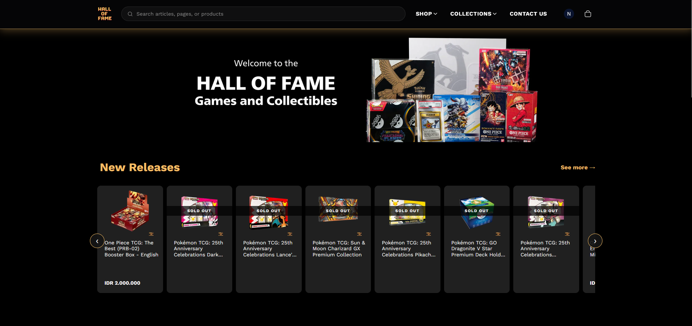
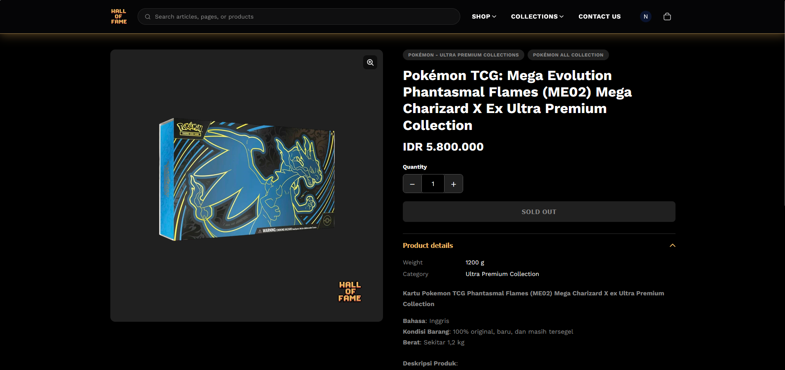
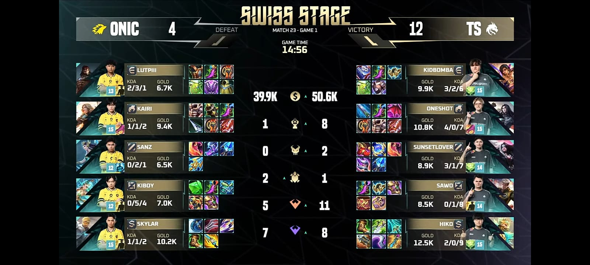
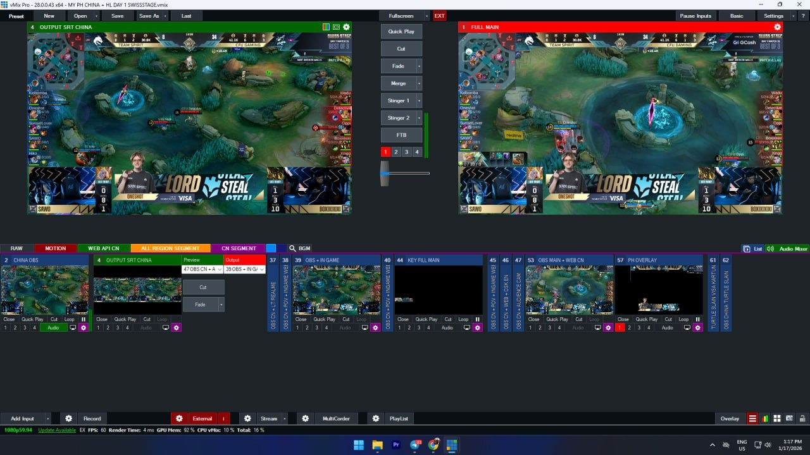

<!--
  HOW THIS FILE WORKS
  - Everything above the first "## " heading is the header: your name (# ), a tagline, and a list of links.
  - Every "## Section" becomes a section and a link in the top menu.
  - Every "### Item" inside a section becomes a card. An italic line right under it (*like this*) is its subtitle.
  - A plain list under "## Skills" shows as tags.
  - Images: put your files in the images/ folder. A paragraph with only images becomes a gallery
    (one image = full width, several = grid). Click an image to view it full screen.
    The text in [brackets] is the caption, e.g. 
  - Supported: **bold**, *italic*, `code`, [links](https://...), , lists, > quotes, ``` code blocks, ---.
  - Comments like this one are hidden from the page.
-->

# I Nyoman Gde Gedar Marchiendo Pradnyana

Fulltime IT Staff - Part Time Fullstack Software Engineer.

- [Email](mailto:nyoman.gedar@gmail.com)
- [GitHub](https://github.com/nyomangedar)
- [LinkedIn](https://www.linkedin.com/in/nyomangedar)

## Projects

### Hall of Fame TCG Marketplace
*2026 · Typescript · Shopify · CSS*

Design and develop a TCG marketplace integrated with Shopify backend. Allowing dynamic data changes and lowering the risk of future maintenance.




<!--[Live demo](https://example.com) · [Source](https://github.com/yourname/project-one)-->

### MLBB International Tournament M7
*2025 · Typescript · MongoDB · NodeJS · NextJS*

Develop the media and design streaming tools allowing live update through MLBB live API. Automating the data feeds and removing the human effort to manually change assets.





<!--[Source](https://github.com/yourname/project-two)-->

## Experience

### Staff IT VAS Core (L2) — Telkomsel
*Jul 2025 – Present*

- Maintained mission critical application (SMSC, UMB, USSD, SMTP Relay) within the transactaion acceptance success rate of >99% 
- Deliver and execute business requirements to support company achievement target 
- Develop AI agents to support automation and knowledge sharing among surroundings internal Telkomsel

### Fullstack Automation Engineer — Huawei
*Dec 2023 – Jul 2025*

- Working as fullstack engineer to develop Network Operations Center ticketing system. Enabling automation and intelligence decision to leverage SLA completion rate.

## Contact

Want to work together or just say hi? Email me at [nyoman.gedar@gmail.com](mailto:nyoman.gedar@gmail.com).
